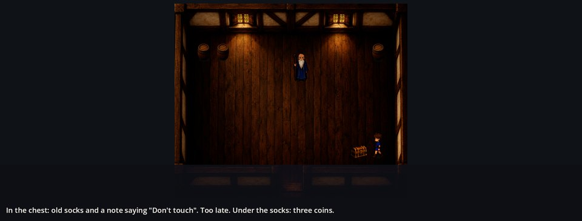

# RPG World — 타일 맵을 걷고, 말하고, 열고, 싸우기

RPG World는 게임을 클래식 2D 롤플레이 게임 스타일의 타일 맵 RPG로 바꿉니다. 키보드로 격자 맵을 걷고, 사람들과 대화하고, 상자를 열고, 문을 지나가고, 몬스터와 싸운 뒤 제자리로 돌아옵니다. 맵은 게임의 평범한 씬이므로 대화창, 시나리오, 저장, 음악, 시간대가 비주얼 노벨에서처럼 맵 위에서 똑같이 작동합니다.

**RPG Plus**의 마을, 숲, 사막이 이 엔진으로 돌아갑니다. 맵과 사람 자체는 RPG Demo 같은 콘텐츠 모드에서 나오며, 이 모드는 규칙을 담당합니다.


## 맵에서 플레이하기

- **이동**은 WASD 또는 방향키입니다. **Shift**를 누르고 있으면 달립니다.
- **상호 작용**은 **E** 또는 **F**: 마주 본 사람과 대화하기, 상자 열기, 표지판 읽기.
- 문이나 맵 가장자리로 **걸어 들어가면** 다음 맵으로 넘어갑니다.
- 일부 지역(예: 숲)에서는 걷다가 **랜덤 전투**가 시작될 수 있습니다.
- 전투가 끝나면 같은 맵의 같은 칸으로 돌아옵니다.
- 게임은 서 있는 위치를 저장하며, 불러오면 그 자리로 돌아갑니다.

상호 작용할 수 있는 칸에는 테두리가 표시되고, 왼쪽 아래 힌트가 **E / F · Interact**로 바뀝니다.

## 예시: 열린 채로 있는 상자

장로의 집 상자는 같은 칸에 놓인 두 이벤트입니다. 스토리 플래그 `rpg_house_chest`가 설정되지 않은 동안은 닫힌 상자가 보이고, 그 시나리오는 동전 세 닢을 주며 플래그를 설정합니다. 이후에는 열린 상자가 대신 표시됩니다.





```json
{ "Id": "chest", "X": 9, "Y": 7, "Tile": 14,
  "Scenario": "rpg_demo/events/house_chest",
  "Condition": "rpg_house_chest != 1" },
{ "Id": "chest_open", "X": 9, "Y": 7, "Tile": 15,
  "Scenario": "rpg_demo/events/chest_empty",
  "Condition": "rpg_house_chest == 1" }
```

```scenario
ptext "상자 안에는 낡은 양말과 '만지지 마시오'라고 쓴 쪽지. 이미 늦었다. 양말 밑에 동전 세 닢." key=rpg_demo/chest/house
action item.add id=money/coin count=3
flag rpg_house_chest 1
end
```

## 작성자용: 맵

맵은 모드의 `maps/` 폴더에 있는 JSON 파일이고, 전투 배경과 환경음을 위해 `scenes/`에 같은 이름의 씬도 하나 필요합니다.

- **그려지는 레이어 3개**, 각 레이어는 타일 번호 행의 목록(`.`은 빈 칸)입니다. `Back` — 지면, 바닥, 물 / `Main` — 캐릭터 높이의 물건: 벽, 나무줄기, 울타리 / `Front` — 캐릭터 위에 그려지는 것: 나무 꼭대기, 처마, 아치.
- **충돌** — 필요한 곳에서 타일 자체의 통과 가능 여부를 덮어쓰는 행 레이어: 절벽 가장자리의 보이지 않는 벽, 울타리의 빈틈.
- **타일셋** — 타일 아틀라스와 타일 속성(막혀 있는지, 지형, 물건).
- **Spawn** — 새로 도착한 사람이 나타나는 위치. **Zoom**. 실내용 선택 **Ambient** 색(없으면 시간대가 맵을 비춥니다), 그리고 **Atmosphere**(`woodland`은 낙엽, 반딧불, 물결을 추가).
- **Encounters** — 랜덤 전투: 평균 `Steps` 걸음마다 한 번, `Groups` 중 하나와.

```json
"Encounters": { "Steps": 48, "Groups": ["rpg_slime", "rpg_slime,rpg_slime"] }
```

## 작성자용: 이벤트

이벤트는 어느 모드의 `map_events/<맵 id>/*.json`에나 있습니다. 이벤트는 **모습**과 **효과**를 따로 고릅니다.

- 모습: 캐릭터 `Sprite`, 아틀라스의 `Tile` 한 장, 땅에 놓인 아이템 `Icon`, 또는 없음(보이지 않는 트리거).
- 효과: 이 맵이나 다른 맵의 칸으로 가는 `Teleport`, 또는 `Scenario`와 선택적인 인라인 `Commands` — `action rpg.battle`, 플래그, 퀘스트를 포함한 시나리오 언어 전부.
- `Trigger`: `Action`(마주 본 채 E/F) 또는 `Touch`(밟기).
- `Solid`: 길을 막는지(그려지는 이벤트는 기본적으로 막습니다).
- `Condition`: 조건이 맞지 않으면 이벤트를 숨깁니다.
- `Pages`: 각자 조건을 가진 대체 모습과 효과. 조건이 맞는 마지막 페이지가 사용됩니다.
- `Route`: 자율 이동. `{"Steps": ["left", "wait", "right"], "Every": 0.8}` 같은 형태로 `up`/`down`/`left`/`right`, `random`, `toward`/`away`(플레이어 쪽으로/반대로), `wait`, `face_…` 사용.
- `Light`: 이벤트 주위의 빛. `{"Radius": 3, "Color": "#ffd8a0"}`. 저녁과 밤에 보입니다.

**다른 모드의 맵에 추가하거나 바꾸기.** 이벤트 파일은 로드 순서대로 합쳐집니다. 새 `Id`는 그 맵에 이벤트를 추가하고, 소유자에게 의존하는 모드가 같은 `Id`를 쓰면 대체합니다. RPG Plus가 데모의 장로에게 새 대화를 주는 방식이 바로 이것입니다.

## 시나리오 액션

```scenario
action rpg.battle enemies=rpg_wolf,rpg_slime win_flag=rpg_wolf_dead
action rpg.teleport map=rpg_forest x=1 y=8 dir=right
```

- `rpg.battle`은 게임의 전투 코어로 전투를 시작하고 같은 칸으로 돌아옵니다. 승리하면 `win_flag`가 1로 설정되어, 그 플래그를 조건으로 검사하는 맵의 몬스터는 사라집니다. 이 액션 뒤에는 시나리오를 끝내세요.
- `rpg.teleport`는 플레이어를 이 맵이나 다른 맵의 칸으로 옮깁니다.

## 게임 설정

- **외형**(`rpg.player_charset`) — 맵 위 주인공 스프라이트. 게임의 캐릭터셋에서 고릅니다.
- **맵 투영**(`tile.renderer`) — 탑다운 또는 아이소메트릭. Tile Rendering 참조.

## 문제가 생겼을 때

1. **인물이나 상자가 반응하지 않는다.** 마주 보고 서서 E 또는 F를 누르세요. `Touch` 이벤트는 밟았을 때만 반응합니다.
2. **몬스터나 상자가 돌아온다.** 그 `Condition`은 시나리오나 `win_flag`가 설정하는 플래그를 검사해야 합니다.
3. **비어 보이는 곳을 걸을 수 없다.** 그 칸은 막힌 타일이나 맵의 충돌 레이어가 막고 있습니다.
4. **전투 배경이 없다.** `scenes/<map>.json`의 맵 씬에 `defaultBackground`가 필요합니다.
