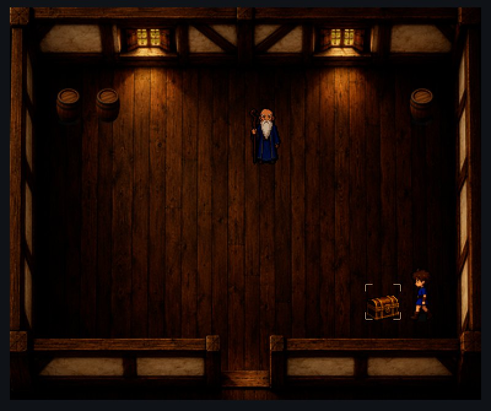

# RPG World — ходите по тайловой карте, говорите, открывайте, сражайтесь

RPG World превращает игру в RPG на тайловых картах в духе классических двухмерных ролевых игр: вы ходите по карте из клеток, разговариваете с людьми, открываете сундуки, проходите через двери, сражаетесь с монстрами — а после боя возвращаетесь на то же место. Карта при этом остаётся обычной сценой игры, поэтому диалоговое окно, сценарии, сохранения, музыка и время суток работают на ней так же, как в визуальной новелле.

На этом движке построены деревня, лес и пустыня **RPG Plus**. Сами карты и их обитатели лежат в контентных модах вроде `rpg_plus_game`; этот мод отвечает за правила.


## Как играть на карте

- **Ходьба** — WASD или стрелки; с зажатым **Shift** герой бежит.
- **Действие** — **E** или **F**: заговорить с тем, кто перед вами, открыть сундук, прочитать табличку.
- **Шагните** на дверной проём или за край карты, чтобы попасть на следующую карту.
- **Случайные бои** могут начинаться прямо на ходу в некоторых местах — например, в лесу.
- После боя вы возвращаетесь на ту же клетку той же карты.
- Игра сохраняет, где вы стоите; загрузка возвращает вас ровно туда же.

Клетку, с которой можно взаимодействовать, обводит рамка, а подсказка слева снизу меняется на **E / F · Взаимодействовать**.

## Пример: сундук, который остаётся открытым

Сундук в доме старейшины — это одно размещение объекта «сундук» с двумя состояниями. Пока не установлен сюжетный флаг `rpg_house_chest`, показан закрытый сундук; его сценарий выдаёт три монеты и ставит флаг. После этого показывается открытое состояние.




```json
{"Id": "rpg_elder_house/chest", "Object": "village_pack/container/chest", "X": 9, "Y": 7,
 "Interact": {"Scenario": "rpg_demo/events/house_chest", "Commands": null},
 "States$add": [{"Id": "open", "When": "rpg_house_chest == 1",
                 "Interact": {"Scenario": "rpg_demo/events/chest_empty", "Commands": null}}]}
```

```scenario
ptext "В сундуке — старые носки и записка: «Не трогай». Поздно. Под носками — три монеты." key=rpg_demo/chest/house
action item.add id=money/coin count=3
flag rpg_house_chest 1
end
```

## Авторам: карты

Карта — это JSON-файл в папке `maps/` мода. Она содержит только землю: то, что стоит на ней (деревья, дома, бочки, люди), задаётся расстановками. Сцена с тем же именем в `scenes/` даёт фон боя и фоновый звук карты.

- **Legend** — одна буква на каждый вид поверхности или ограды: `"g": "village_pack/ground/grass"`. Точка `.` — пустая клетка.
- **Ground** и **Structure** — строки букв по клеткам: поверхности (трава, вода, пол) и ограды или стены.
- **Collision** — строки `#` (непроходимо), `o` (проход открыт принудительно, например разрыв в стене) и `.` (решают объекты).
- **Spawn**, **Zoom**, **Ambient** (фиксированный цвет света для интерьеров), **Atmosphere** (`woodland`, `winter_snow`, `desert_dust`, `rain`) и **Encounters** (`Steps` и `Groups`):

```json
"Encounters": { "Steps": 48, "Groups": ["rpg_slime", "rpg_slime,rpg_slime"] }
```

## Авторам: объекты и расстановки

Объекты описаны в `objects/*.json` (`rpg_object`). Расстановка ставит один объект на карту: файл `placements/<карта>/*.json` (`rpg_placement`) с `Id` вида `<карта>/<имя>`, полями `Object`, `X`, `Y` и теми полями, которые меняют только этот экземпляр.

- **Form** — `surface` (поверхность), `segment` (кусок ограды, соединяется с соседями), `sprite` (картинка на области клеток: деревья, дома, бочки, двери) или `actor` (персонаж с шагающим спрайтом).
- **Solid** — блокирует ходьбу. Спрайт блокирует по умолчанию; у триггера нужно `"Solid": false`.
- **Interact** — `Trigger`: `Use` (E или F, стоя лицом) или `Step` (шаг на клетку); затем одно из `Scenario`, `Commands` (строки языка сценариев) или `Teleport` (`{Map, X, Y, Dir}`).
- **States** — `When` (условие) и что меняется: `Hidden`, другая картинка, `Interact`, `Route`. Действует последнее состояние, чьё `When` выполнено. В расстановке `self.имя` — её собственный флаг `<Id>:имя`.
- **Route**, **Light** и **Lights** — как прежде (`Steps`, `Every`; свечение с `Radius`, `Color` и смещением `At` в клетках от объекта).
- **Extends** и **Variants** — наследование от другого объекта и варианты (например, зимний).
- **Добавить на карту чужого мода** — положите расстановку со своим `Id`. Заменить чужую — тем же `Id` с `depends` на владельца; удалить — патчем с `"$delete": true`.
- **Облик героя** — спрайт лидера группы (`Charset` персонажа, например `village/hero`).

## Действия сценариев

```scenario
action rpg.battle enemies=rpg_wolf,rpg_slime win_flag=rpg_wolf_dead
action rpg.teleport map=rpg_forest x=1 y=8 dir=right
```

- `rpg.battle` запускает бой боевым ядром игры и возвращает героя на ту же клетку; при победе `win_flag` получает значение 1 — и монстр на карте, чьё условие проверяет этот флаг, исчезает. После этого действия сценарий нужно завершать.
- `rpg.teleport` переносит игрока в клетку этой или другой карты.

## Настройки игры

- **Проекция карты** (`tile.renderer`) — вид сверху или изометрия; см. Tile Rendering.

## Если что-то пошло не так

1. **Персонаж или сундук не реагирует.** Встаньте к нему лицом и нажмите E или F. Объект с `Step` срабатывает, когда вы на него заходите.
2. **Монстр или сундук возвращается.** Состояние, которое его прячет или меняет, должно проверять тот флаг, который выставляет его сценарий или `win_flag`.
3. **Не пройти туда, где вроде бы открыто.** Клетку блокирует твёрдый объект (`Solid`) или `#` в слое коллизий карты.
4. **Нет фона для боя.** Сцене карты в `scenes/<map>.json` нужен `defaultBackground`.
