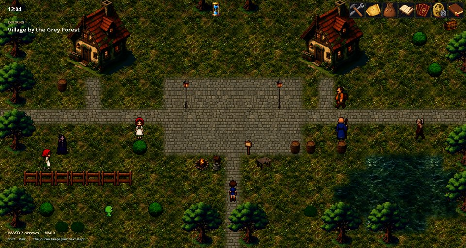
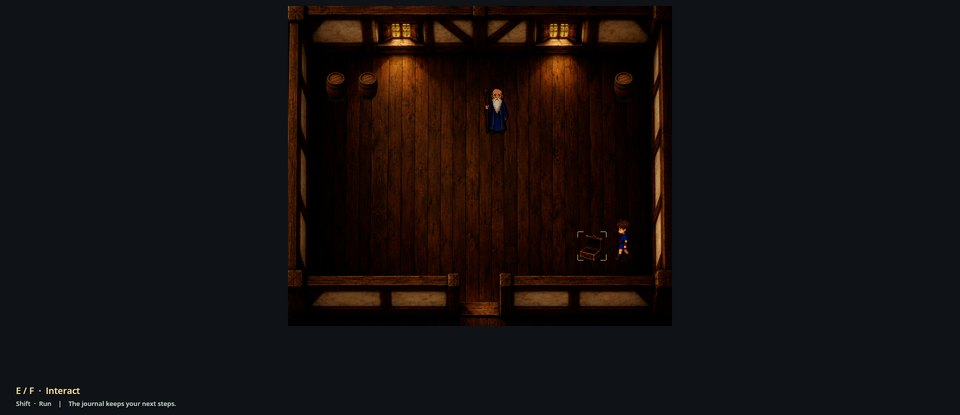

# RPG World — 在图块地图上行走、交谈、开启与战斗

RPG World 把游戏变成经典 2D 角色扮演风格的图块地图 RPG：用键盘在网格地图上行走，与人交谈，打开宝箱，穿过房门，与怪物战斗——打完再回到原地。地图本身就是游戏的普通场景，所以对话框、剧本、存档、音乐和昼夜变化在地图上的表现与视觉小说里完全一样。

**RPG Plus** 的村庄、森林和沙漠都由它驱动。地图和人物本身来自 RPG Demo 之类的内容模组；这个模组提供的是规则。



## 在地图上怎么玩

- **行走**用 WASD 或方向键；按住 **Shift** 奔跑。
- **互动**用 **E** 或 **F**：与面前的人交谈、打开宝箱、阅读告示牌。
- **走上**门口或地图边缘即可前往下一张地图。
- 在某些地方（例如森林）行走时可能触发**随机战斗**。
- 战斗结束后，你会回到原地图的原格子。
- 游戏会保存你站立的位置；读档后回到原地。

可以互动的格子会被框起来，左下角的提示随之变为 **E / F · Interact**。

## 示例：保持开启的宝箱

长者之家的宝箱由同一格子上的两个事件组成。剧情旗标 `rpg_house_chest` 未设置时显示关闭的宝箱；它的剧本会给出三枚硬币并设置旗标。此后改而显示打开的宝箱。




```json
{ "Id": "chest", "X": 9, "Y": 7, "Tile": 14,
  "Scenario": "rpg_demo/events/house_chest",
  "Condition": "rpg_house_chest != 1" },
{ "Id": "chest_open", "X": 9, "Y": 7, "Tile": 15,
  "Scenario": "rpg_demo/events/chest_empty",
  "Condition": "rpg_house_chest == 1" }
```

```scenario
ptext "箱子里：旧袜子和一张写着"别碰"的纸条。太迟了。袜子下面有三枚硬币。" key=rpg_demo/chest/house
action item.add id=money/coin count=3
flag rpg_house_chest 1
end
```

## 给作者：地图

地图是模组 `maps/` 文件夹里的一个 JSON 文件，另外还要在 `scenes/` 里放一个同名场景，用于战斗背景和地图的环境音。

- **三个绘制图层**，各是一份按行排列的图块编号列表（`.` 表示空）：`Back`——地面、地板、水；`Main`——与角色同层的物件：墙、树干、栅栏；`Front`——绘制在角色之上：树冠、屋檐、拱门。
- **碰撞**——一层按行记录的数据，在需要的地方覆盖图块自身的通行性：悬崖边的隐形墙，或树篱上的缺口。
- **图块集（tileset）**——图块图集以及各图块的属性（是否实心、地表、物件）。
- **Spawn**——新到来者出现的位置；**Zoom**；可选的 **Ambient** 颜色，用于室内（否则地图由昼夜光照）；以及 **Atmosphere**（`woodland` 会添加落叶、萤火虫和水面涟漪）。
- **Encounters**——随机战斗：平均每走 `Steps` 步遇到一次，对手是 `Groups` 中的一组。

```json
"Encounters": { "Steps": 48, "Groups": ["rpg_slime", "rpg_slime,rpg_slime"] }
```

## 给作者：事件

事件存放在任意模组的 `map_events/<地图 id>/*.json` 中。每个事件都有相互独立的**外观**和**效果**：

- 外观：角色 `Sprite`、图块集里的单个 `Tile`、放在地上的物品 `Icon`，或者什么都不画（隐形触发器）；
- 效果：`Teleport` 到本地图或另一张地图的某格，或者 `Scenario` 加可选的内联 `Commands`——完整的剧本语言，包括 `action rpg.battle`、旗标和任务；
- `Trigger`：`Action`（面向它按 E/F）或 `Touch`（踩上去）；
- `Solid`：是否挡路（画出来的事件默认挡路）；
- `Condition`：条件不成立时隐藏事件；
- `Pages`：备选的外观和效果，各自带条件；使用最后一条条件成立的页面；
- `Route`：自主移动，例如 `{"Steps": ["left", "wait", "right"], "Every": 0.8}`，可用 `up`/`down`/`left`/`right`、`random`、`toward`/`away`（朝向或远离玩家）、`wait` 和 `face_…`；
- `Light`：事件周围的光晕，`{"Radius": 3, "Color": "#ffd8a0"}`，黄昏和夜晚可见。

**增补或修改其他模组的地图。** 事件文件按加载顺序合并：新的 `Id` 向地图添加事件；依赖地图归属模组的模组若使用相同的 `Id`，则替换该事件。RPG Plus 就是这样给演示版的年长者加上新对话的。

## 剧本动作

```scenario
action rpg.battle enemies=rpg_wolf,rpg_slime win_flag=rpg_wolf_dead
action rpg.teleport map=rpg_forest x=1 y=8 dir=right
```

- `rpg.battle` 用游戏的战斗核心开启一场战斗，并回到同一格；胜利时 `win_flag` 被置为 1，于是地图上条件检查该旗标的怪物就会消失。这个动作之后应结束剧本。
- `rpg.teleport` 把玩家移动到本地图或另一张地图的某格。

## 游戏设置

- **外观**（`rpg.player_charset`）——主角在地图上的精灵，从游戏的字符图（charset）中选择。
- **地图投影**（`tile.renderer`）——俯视或等距；参见 Tile Rendering。

## 如果遇到问题

1. **人物或宝箱没有反应。** 面对它按 E 或 F；`Touch` 事件只有踩上去才会触发。
2. **怪物或宝箱又出现了。** 它的 `Condition` 必须检查它的剧本或 `win_flag` 所设置的旗标。
3. **看起来能走的地方走不过去。** 那个格子被实心图块或地图的碰撞层挡住了。
4. **战斗没有背景。** 地图在 `scenes/<map>.json` 中的场景需要 `defaultBackground`。
